<p align="center">
  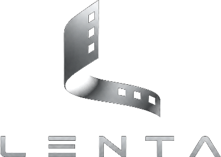
</p>

<p align="center">
  <b>Your own streaming service at home.</b><br>
  A free, self-hosted media server and web player for your movies, TV shows, music, audiobooks and photos.
  Created with the idea to give us more power, flexibility and privacy than Plex and Jellyfin.
</p>

https://github.com/user-attachments/assets/ecd20a9b-4fea-4781-9b54-c5688e15229c

<p align="center">
  
  
  
  
  
</p>

<p align="center">
  <a href="docs/INSTALL.md"><b>Install guide</b></a> ·
  <a href="docs/USER-GUIDE.md"><b>User guide</b></a> ·
  <a href="docs/INSTALL.md#troubleshooting"><b>Troubleshooting</b></a> ·
  <a href="docs/INSTALL.md#faq"><b>FAQ</b></a>
</p>

---
I wanted a media organizer which gives me more than what Plex and Jellyfin do. This project is and probably is going to be forever work-in-progress. 
I am working on an Android app and support for Samsung TVs 2017 onwards. You would see this in the source - you can try and use them but they are not stable at all (maybe the Android app is bit better). 
I am doing this just for the fun of it - I am in no way a professional. This project is completely FREE to everyone. Do whatever you like with it. Contributions and ideas are highly appreciated! 

LENTA runs on one Linux machine in your home, reads your media folders, finds posters, descriptions,
cast and trailers, and streams everything to any browser, phone or tablet on your network. When a device
can't play a file as it is, LENTA converts it on the fly, on your graphics card if you have one.

No accounts, no subscriptions, no cloud, no tracking. Your media stays on your disks.

HTTP and HTTPS run side by side out of the box, with LENTA's own certificate or yours ([HTTPS guide](docs/INSTALL.md#https)).

<p align="center">

</p>

<p align="center">
  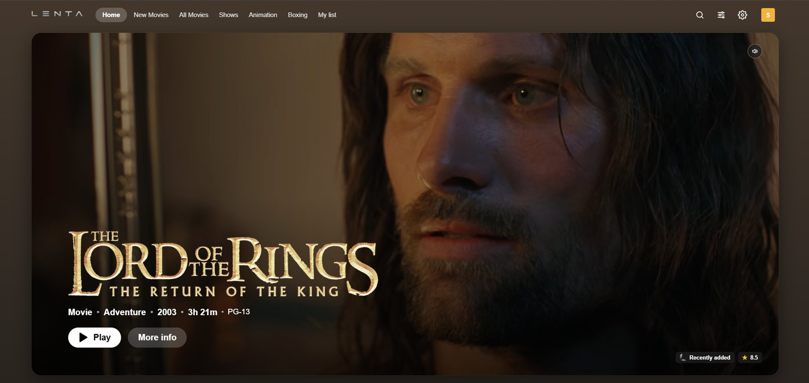
</p>

<p align="center"><a href="#-screenshots"><b>More screenshots ↓</b></a></p>

## 📸 Screenshots

### Live TV

<table>
  <tr>
    <td width="50%" valign="top">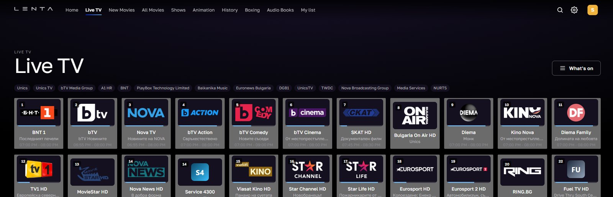<br><b>Your channels, with their logos.</b> Everything the tuner found, in the order the network numbers them, with what is on now under each one. The row of names across the top filters by who provides the channel.</td>
    <td width="50%" valign="top">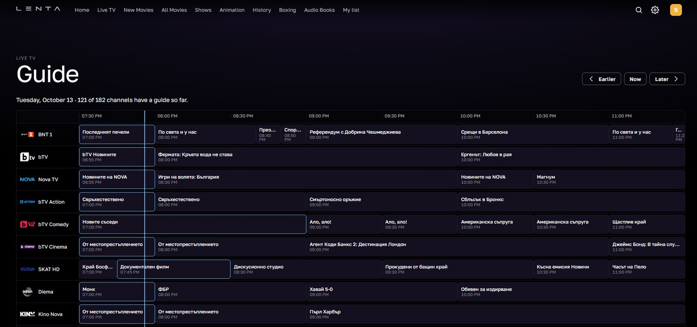<br><b>The guide.</b> Read from the broadcast itself — no internet service, no subscription, no account. <i>Earlier</i>, <i>Now</i> and <i>Later</i> move through it, and the line marks the present.</td>
  </tr>
  <tr>
    <td width="50%" valign="top">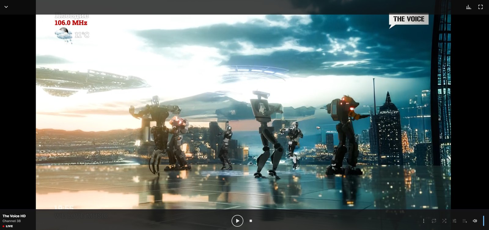<br><b>A channel plays in the same player as everything else</b> — with the things a broadcast has no use for taken away, and a <b>LIVE</b> mark where the clock would be.</td>
    <td width="50%" valign="top">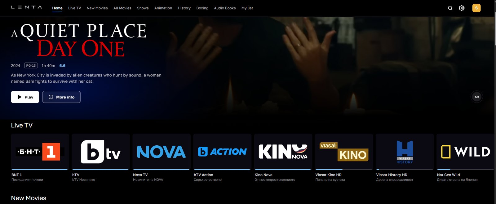<br><b>Your own channels on Home.</b> Pick the ones you actually watch and they sit as a row among your films, each showing what is on.</td>
  </tr>
  <tr>
    <td width="50%" valign="top">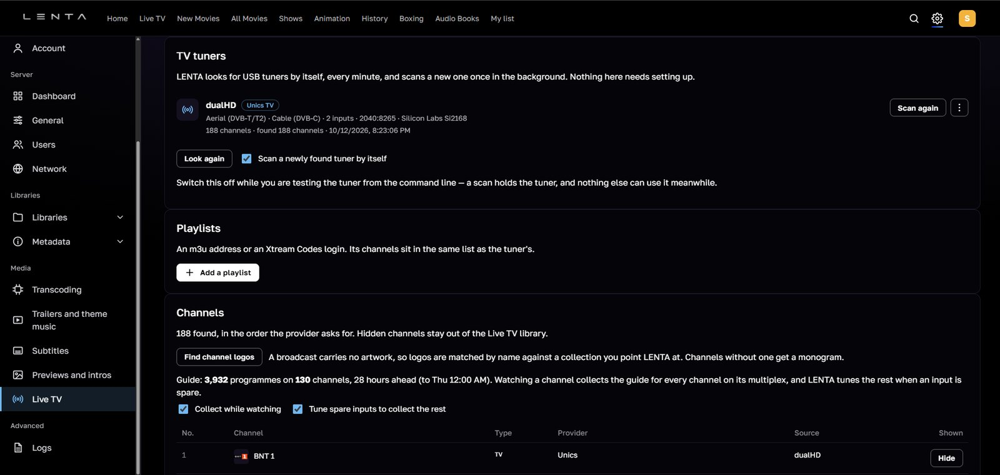<br><b>Nothing to set up.</b> LENTA finds a USB tuner by itself and scans it once in the background. <i>Settings › Live TV</i> is where you see what it found, how much guide it has collected, and which channels are shown.</td>
    <td width="50%" valign="top"><p align="center">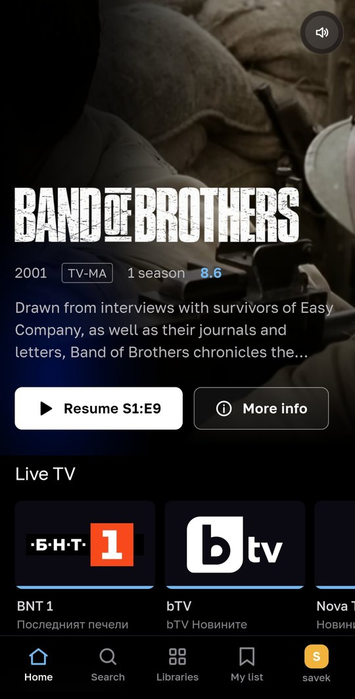</p><b>The Android app.</b> The same library on a phone, Live TV included: full-screen video sideways, picture-in-picture when you press Home, and music and audiobooks with the screen off.</td>
  </tr>
</table>

### The rest

<table>
  <tr>
    <td width="50%" valign="top">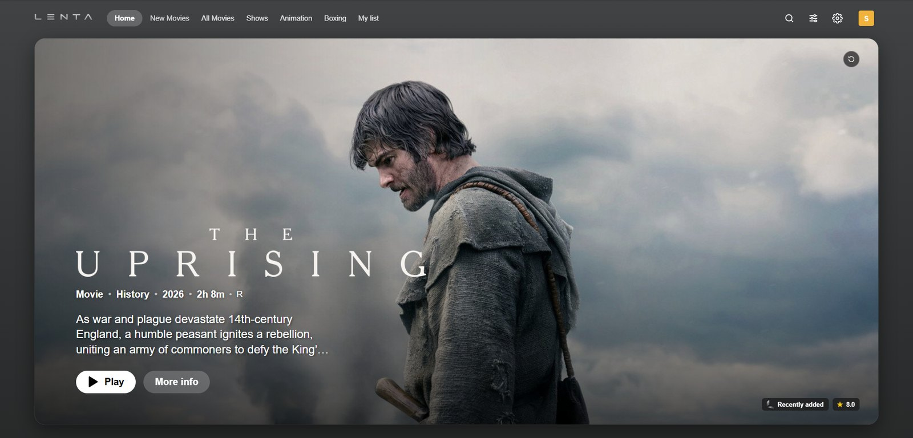<br><b>Featured banner.</b> A title from your libraries plays its trailer in the background, with sound that fades in and out.</td>
    <td width="50%" valign="top">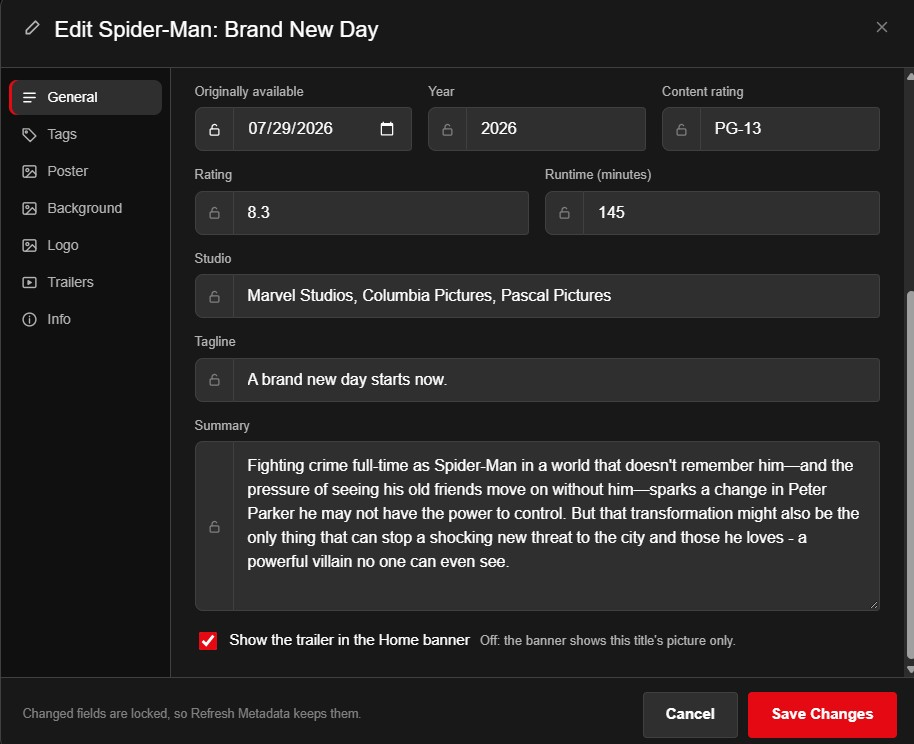<br><b>You pick the banner trailers.</b> Tick <i>Show the trailer in the Home banner</i> in a title's Edit dialog; until you do, the banner shows pictures only.</td>
  </tr>
  <tr>
    <td width="50%" valign="top">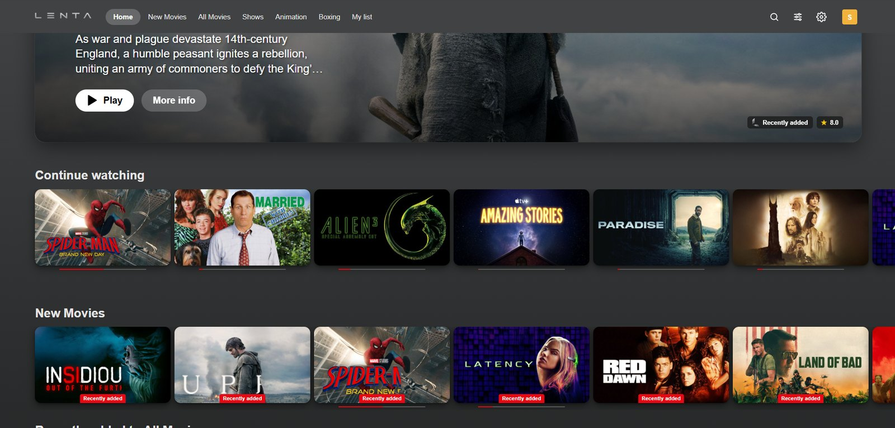<br><b>Home rows.</b> Continue watching with progress bars, new movies, recently added, and rows you make yourself.</td>
    <td width="50%" valign="top">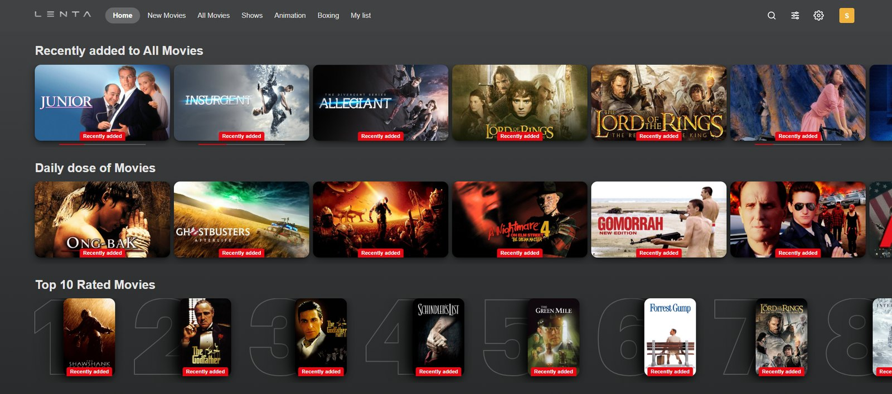<br><b>Top 10.</b> The highest-rated titles on your server, with big ranking numbers.</td>
  </tr>
  <tr>
    <td width="50%" valign="top">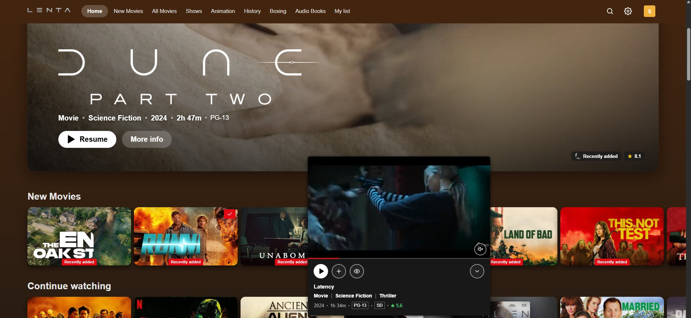<br><b>Hover previews.</b> Rest the pointer on a title: a larger card plays its trailer, with Play, My list, Watched and the details.</td>
    <td width="50%" valign="top">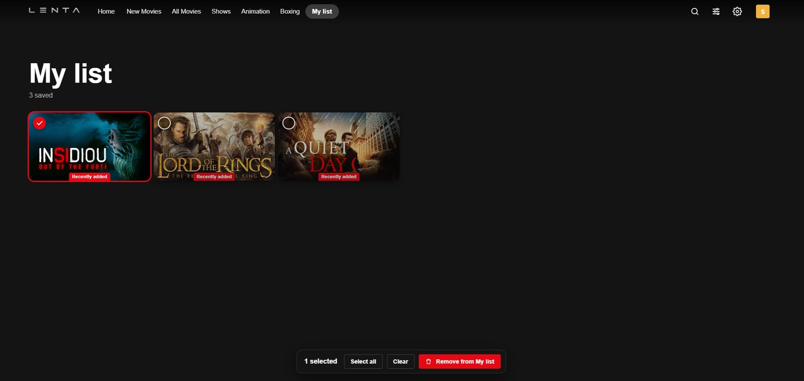<br><b>My list.</b> Pick one or many titles and remove them in one go.</td>
  </tr>
  <tr>
    <td width="50%" valign="top">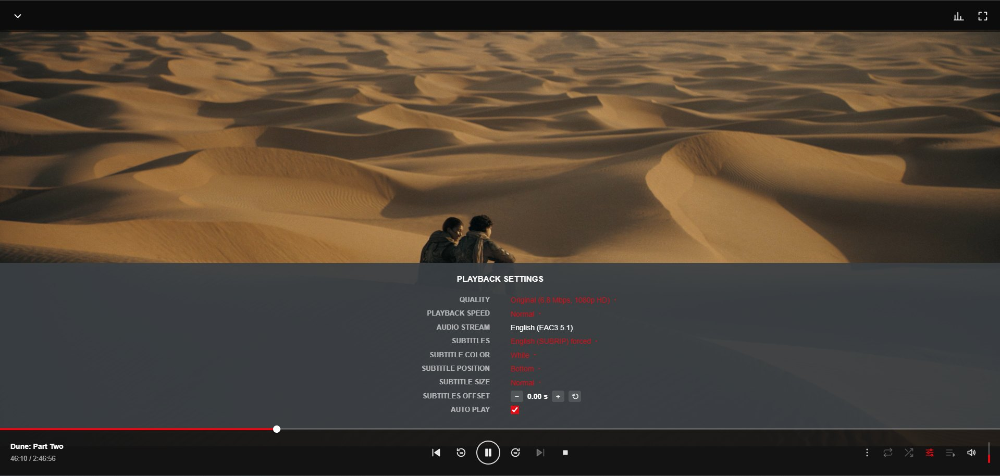<br><b>Plex-style player.</b> One player bar for films, episodes, music and audiobooks, with <i>Playback settings</i> for quality, speed, audio, subtitles and auto play.</td>
    <td width="50%" valign="top">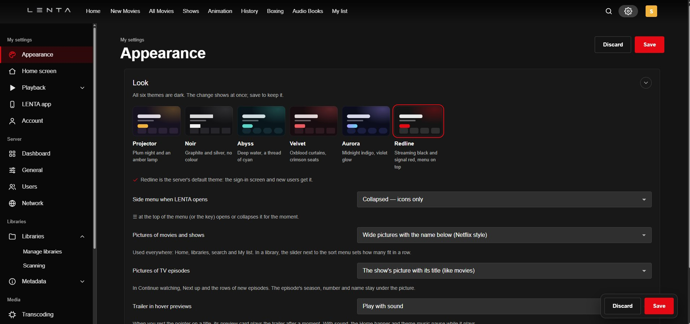<br><b>One Settings page.</b> A sidebar with your own settings and the server's; one Save, with Discard, for each page.</td>
  </tr>
  <tr>
    <td width="50%" valign="top">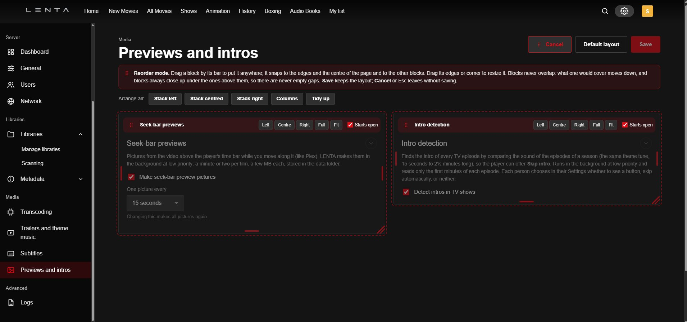<br><b>Arrange it your way.</b> Reorder mode lets you drag, resize and place the blocks of any Settings page wherever they fit you best.</td>
    <td width="50%" valign="top">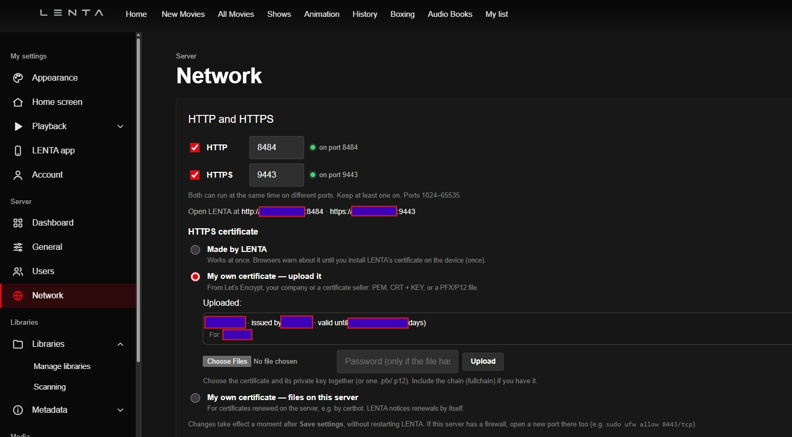<br><b>HTTP and HTTPS.</b> Both run side by side on ports you choose. Use LENTA's own certificate, upload yours (PEM or PFX), or point at Let's Encrypt files. All from <i>Settings › Network</i>.</td>
  </tr>
</table>

<sub>Film posters, artwork and stills in these screenshots belong to their respective owners and are shown only
to illustrate how LENTA displays your own library. They are not part of LENTA and not covered by its license.</sub>

## 🆕 What's new in 1.8

Everything since 1.2 has gone into two things: **live television**, and **watching on a TV**.

**Live TV — it plays now.** 1.4 could find a USB tuner and scan it; since 1.6 you can watch what it finds.
- 📺 **Channels play.** LENTA tunes a free input, picks that one programme off the multiplex and sends it
  to the same player everything else uses. A channel already in H.264 and AAC is passed through untouched;
  only the ones that need it are converted, on the graphics card when there is one.
- 📅 **A programme guide**, read from the broadcast itself — no internet service and no subscription. What
  is on now and next appears under every channel, and the **Guide** page shows the grid. The multiplexes
  nobody is watching fill themselves in between viewings, and a viewer always outranks that sweep.
- ⚡ **Channels stay ready.** Going back to a channel you were just watching is instant: up to five are kept
  warm for half an hour each, and starting a new one never disturbs the one already playing. Channel ▲ and
  ▼ on a TV remote change channel.
- 🖼️ **Every channel has artwork**, matched by name against the station's own logo, with a monogram for
  whatever is left over — and your country decides which version of a channel you get.
- 🔢 Channel numbers are the ones the network asks for, a channel carried on two frequencies is listed
  once, and scrambled channels arrive hidden.
- 🏠 **Put your own channels on Home**, as a row of their own alongside your films.

**Watching on a television.**
- 📱 A **Samsung TV app**, installed from your own server, for every Samsung set from **2017 onwards** —
  sets before 2023 get the whole client rewritten for their older engine. See the
  [Samsung TV guide](docs/SAMSUNG-TV.md).
- 🎛️ Remote-control navigation throughout: arrows, OK, Back, the play keys and the channel keys.
- 🖥️ A client built for what a television can actually paint, so the picture gets the machine rather than
  the decoration.

**Also since 1.2**
- 🎨 An **HBO Max** theme, and *Redline* renamed to **Netflix**.
- 🎧 An **Audiobooks** library type, with chapters, series, narrators and covers.
- 🖥️ **One Plex-style player bar** for films, episodes, music and audiobooks, with *Playback settings*.
- 🔐 **HTTPS** next to HTTP, set up entirely from *Settings › Network* (screenshot above).
- ⚙️ **One Settings page** with a sidebar, every page rearrangeable.
- Plus a great many smaller fixes; see the [changelog](CHANGELOG.md).

## ✨ Features

**Watching**
- 🎬 Netflix-style home with a featured banner and rows: *Continue watching*, *Next up*, *Recently added*, *My list*
- 🎞️ Banner trailers for the titles **you** pick: tick *Show the trailer in the Home banner* in a title's Edit dialog
  ([how](docs/USER-GUIDE.md#trailers-in-the-home-banner-tick-them-per-title); none are ticked at first)
- ▶️ Hover previews that play the trailer and carry on to the exact frame on the title page
- 🖥️ A Plex-style player: one player bar for films, episodes, music and audiobooks, with a preview picture on the time bar,
  *Playback settings* (quality, speed, audio, subtitles and their colour, size, position and timing, auto play) and a *Play queue*
- 🔽 Minimise any video into the player bar and keep browsing; the page's trailers play muted meanwhile
- 🎵 Music with repeat, shuffle and a play queue; photo albums with a swipeable viewer
- 📡 **Live TV**: USB tuners found and scanned by themselves (DVB-T/T2 and DVB-C, with the provider and
  its channel numbers read from the broadcast), channels that play in the same player as everything else,
  a **programme guide read from the broadcast**, station logos, channels kept warm so going back to one is
  instant, and m3u and Xtream playlists in the same channel list
- 🎧 Audiobooks: books found in any folder layout, chapters, speed, ±15/30 s, your place kept across devices,
  covers and descriptions from Google Books and Open Library (no key needed)
- 🎨 Seven dark themes, two of them modelled on services you know — a **Netflix** one and an **HBO Max** one,
  both with the menu as a bar along the top — plus poster or landscape artwork, grid, detail and table views
- ⚙️ One Settings page with a sidebar (yours and the server's), every page rearrangeable

**Your library, done for you**
- 🔍 Understands real-world file names, release names, collection folders and the Plex/Jellyfin layout
- 🖼️ Artwork from your own files, embedded covers, TMDB, Fanart.tv, OMDb and AniList, in the order you choose
- ⭐ TMDB and IMDb ratings, plus Rotten Tomatoes and Metacritic with an OMDb key
- 📖 About panel: director, writers, music, budget, box office, Wikipedia summary, other films in the collection
- 🎞️ Trailers from your own files, Apple TV, KinoCheck's official picks or YouTube, and theme music
- 💬 Subtitles: embedded, next to the file, or downloaded from OpenSubtitles automatically
- ✏️ Edit any title by hand; locked fields survive every refresh

**Streaming that just works**
- ⚡ Direct play when the device can, light repackaging when it nearly can, full conversion when it must
- 🚀 Hardware conversion on NVIDIA (NVENC), Intel Quick Sync and AMD/Intel VA-API, with HDR tone mapping
- 📱 Phone and tablet layouts, an installable web app, a small **Android app (APK)** — full-screen video sideways,
  picture-in-picture when you press Home, music and audiobooks with the screen off — and a **Samsung TV app**
  with remote-control navigation
- 🔐 HTTP and HTTPS side by side, switched and set up from the web page: LENTA's own certificate (renewed by itself)
  or yours (upload PEM/PFX, or point at Let's Encrypt files on the server)
- 👨‍👩‍👧 Several users, each with their own watch history, *My list* and library access

**Easy to run**
- 🐧 One command to install on Ubuntu, one command to update
- 🔒 Runs as its own unprivileged account; your media is only ever read
- 🧰 **Never installs or touches graphics drivers**: it uses the ones you have
- 📂 You choose where its data lives, and can move it later with one command

## 🚀 Quick start

On Ubuntu 24.04 or 26.04 (64-bit x86):

```bash
git clone https://github.com/vladsavekovv/lenta.git
cd lenta
sudo ./deploy/install.sh
```

Then:

1. Let LENTA read your media: `sudo setfacl -R -m u:lenta:rX -m d:u:lenta:rX /path/to/media`
2. Open `http://<server-address>:8484` and create the administrator account.
3. Paste a free [TMDB API key](https://www.themoviedb.org/settings/api) in **Settings › Metadata › TMDB and language**.
4. Add your libraries in **Settings › Libraries › Manage libraries**.

**👉 New to this? Follow the [step-by-step install guide](docs/INSTALL.md).** It covers requirements,
permissions, NAS shares, graphics cards, phones, remote access, updates, backups and troubleshooting.

## 📚 Documentation

| Guide | What's in it |
|---|---|
| [**Install guide**](docs/INSTALL.md) | Requirements, installation, first setup, GPU, NAS, remote access, updating, backups, uninstalling, troubleshooting, FAQ |
| [**User guide**](docs/USER-GUIDE.md) | Naming your files, libraries, the apps, themes, subtitles, trailers, metadata and artwork, users, shortcuts, API |
| [**Samsung TV**](docs/SAMSUNG-TV.md) | !! WORK IN PROGRESS !! Watching on a Samsung TV: the TV's browser, or the LENTA TV app installed from your server |
| [**Contributing**](CONTRIBUTING.md) | Running from source, project layout, rebuilding the Android app (WORK IN PROGRESS), sending changes |
| [**Third-party notices**](THIRD-PARTY-NOTICES.md) | The open-source pieces and data services LENTA uses |

## 🧩 How it fits together

```
 [ Your files ] ──► ( LENTA Media Server ) ◄── home network / VPN ──► [ LENTA in a browser ]
   local disks        Python · SQLite · FFmpeg                          computer · phone · tablet · TV
   NAS shares         port 8484                                         or the LENTA Android app
```

- **Server** (`server/`): Python (FastAPI) with an SQLite database. Scans folders, fetches metadata,
  decides how each file is played and runs FFmpeg when it has to convert.
- **Web client** (`web/`): plain HTML, CSS and JavaScript, nothing to build. Fonts and the video library
  are bundled, so it works without internet.
- **Android app** (`android/`): a small full-screen app that opens your LENTA server. Built without the Android
  SDK — the Dalvik code, the manifest and the signature are written by Python scripts in that folder.

## ❓ Questions

- **Is it free?** Yes, completely, for everyone. It is in the public domain. See [License](#-license).
- **Does it need internet?** Only for installing and for metadata, trailers and subtitle downloads.
  Playback at home works offline.
- **Does it replace Plex or Jellyfin?** It does the same job and can run next to them on the same media.

More in the [FAQ](docs/INSTALL.md#faq).

## 🤝 Contributing

Bug reports, ideas and pull requests are welcome. Please read [CONTRIBUTING.md](CONTRIBUTING.md) first,
and use the issue templates so we get the details needed to help.

## 📜 License

LENTA is free and unencumbered software released into the **public domain** under [the Unlicense](LICENSE).
Anyone may use, copy, change, share or build on it, for any purpose, without asking and without paying.
No copyright is claimed on LENTA's own code, artwork or documentation.
Bundled and downloaded third-party components keep their own licenses, listed in
[THIRD-PARTY-NOTICES.md](THIRD-PARTY-NOTICES.md).

This product uses the TMDB API but is not endorsed or certified by TMDB. IMDb ratings come from the
[IMDb Non-Commercial Datasets](https://developer.imdb.com/non-commercial-datasets/), which IMDb allows for
personal, non-commercial use only: anyone using LENTA otherwise should switch IMDb ratings off (Settings ›
Metadata › About panel extras). The same goes for each online service: its data stays under its own terms. LENTA is not affiliated with Netflix, Plex, Jellyfin, IMDb, TMDB, Apple or any of
the services it can connect to. You are responsible for the media you add to it.
